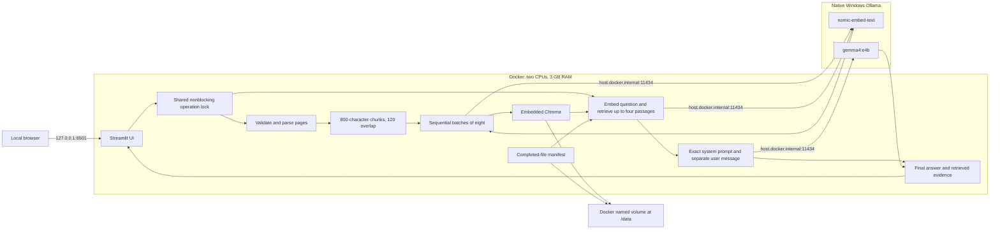

# High-level design

## Boundaries

Local Research is a single-user, single-process document RAG application. A Windows host with four CPU cores and 16 GB RAM runs Ollama natively. A Linux Docker container runs Streamlit, focused LangChain integration packages, and embedded persistent Chroma. There is no separate vector database service, Ollama container, cloud inference service, external search, or authentication layer.

The browser only reaches Streamlit through host loopback. The container accesses Ollama using the fixed Docker Desktop hostname. Ollama must accept the Docker-host connection; Windows Firewall must limit exposure as needed. Native Ollama is outside the container's CPU/RAM limits.

## Pipeline

1. The user selects PDF, TXT, or Markdown uploads and explicitly requests indexing. File-count, byte-size, extension, PDF-page, extracted-character, and chunk-count limits bound ordinary ingestion.
2. Files are hashed; completed duplicates are skipped. PDFs are extracted one page at a time. Text files are decoded as UTF-8. The splitter retains page boundaries and produces labeled chunks.
3. Before model work, the app checks Ollama connectivity and both required models. Batches of eight chunks are embedded serially and upserted into Chroma with deterministic IDs.
4. After all vectors for one file are stored, an atomic manifest replacement makes that file visible. A failed file remains invisible; earlier completed files stay available. Interrupted vectors are cleaned before the next indexing run.
5. A question is embedded, and cosine similarity selects up to four chunks filtered to completed file hashes. No-history system/user messages go to the LLM. The UI presents final answer content and the retrieved passages separately.
6. Clear-library first commits an empty manifest, then deletes all vectors. A crash during deletion cannot restore search visibility.

## Storage and coordination

The default `/data/chroma` directory contains Chroma persistence and a versioned `manifest.json`. Both live on the same named volume, survive normal restarts and `docker compose down`, and must be backed up together with the app stopped. Original uploaded files are not archived. Extracted text remains in Chroma until cleared. Session memory holds uploads and the latest answer; the model prompt never consumes conversation history.

One process-wide nonblocking lock serializes indexing, querying, clearing, and manual model discovery. Competing sessions receive a busy message. Streamlit resource caching reuses the library, and the canonical imported application module owns the lock across reruns. Counts read an atomic manifest snapshot without acquiring the operation lock. Multiple application processes/replicas are unsupported.

## Resources and failure boundaries

The app container uses two CPUs and 3 GB RAM. Numerical-library and Chroma HNSW indexing threads are capped at one. Native model calls request three CPU threads, a 4,096-token LLM context, and at most 1,024 generated tokens. Both model clients use `keep_alive=0`; native Ollama is configured for one parallel request and one loaded model. This favors low resident memory over latency.

These controls do not guarantee the host cannot stall: PDF decompression/text extraction may allocate memory before post-extraction limits run, and native Ollama has independent resource use. CPU generation, model swapping, large Unicode prompts, disk exhaustion, and malformed documents remain practical limits.

The health check proves only that Streamlit responds. Model checks and timeouts have separate user-visible failures. No automatic retries or model downloads occur. An empty library returns the fixed refusal without a model call; insufficient nonempty evidence depends on model compliance. The exact supplied prompt is retained, so document prompt injection is not structurally eliminated. This is a trusted local document tool, not an isolated untrusted-file service.
